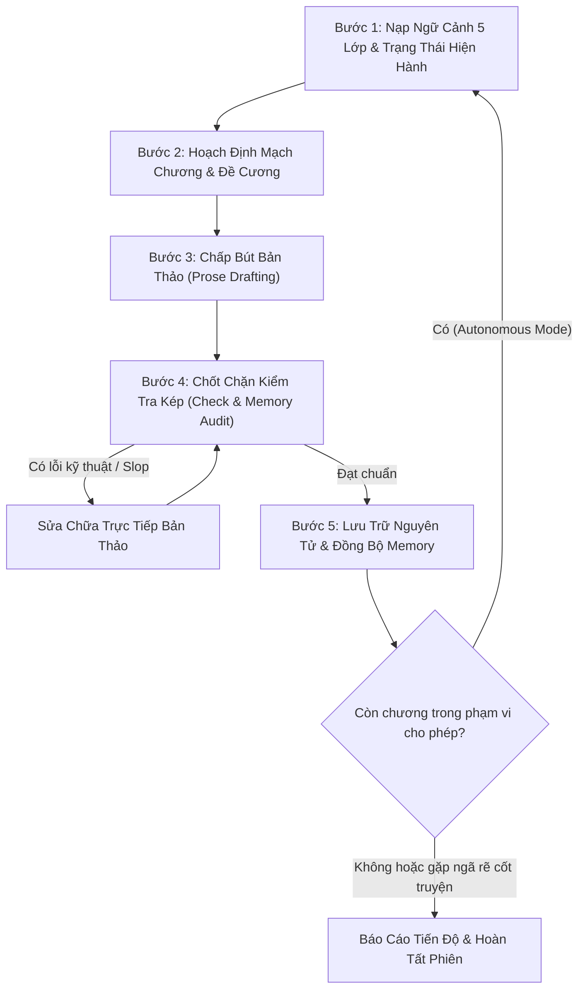

# /story-flow: Điều Phối Toàn Trình Sáng Tác Dài Hạn (Orchestrator)

Đóng vai trò là **Tổng Điều Phối (Orchestrator)** cho tiểu thuyết dài tập, kết nối các khâu chuẩn bị ngữ cảnh, đề cương, phong cách, chấp bút, kiểm định continuity và cập nhật bộ nhớ thành một chu trình bền vững qua hàng chục hoặc hàng trăm chương.

> **Phân định rõ ràng với `/story-write`:**
> - `/story-write`: Dành cho tác giả muốn đồng hành, duyệt chi tiết từng đoạn thoại và tinh chỉnh trực tiếp từng phân cảnh.
> - `/story-flow`: Dành cho việc điều phối toàn trình một hoặc nhiều chương theo mục tiêu định sẵn, có cơ chế tự kiểm tra, tự sửa lỗi kỹ thuật và chỉ dừng lại xin ý kiến khi gặp ngã rẽ cốt truyện hoặc mâu thuẫn Canon nghiêm trọng.

---

## 🧭 HAI CHẾ ĐỘ VẬN HÀNH (TWO OPERATING MODES)

### 1. Chế độ Tương Tác (Interactive Mode)
- Phù hợp khi viết từng chương quan trọng, cao trào Arc, hoặc khi tác giả muốn xem xét kết quả sau mỗi chương trước khi tiếp tục.
- Agent thực hiện chu trình: Nạp ngữ cảnh → Soạn thảo → Chạy audit → Báo cáo kết quả → Chờ tác giả xác nhận → Lưu và cập nhật Narrative Memory.

### 2. Chế độ Tự Hành Nhiều Chương (Autonomous Mode)
- Phù hợp khi tác giả đã duyệt đề cương cho một chặng (ví dụ: viết từ Chương 5 đến Chương 8) và cho phép AI tự hành trong phạm vi đã định.
- **Chu trình lặp tự hành cho từng chương (Autonomous Loop):**
  1. **Đọc trạng thái hiện tại:** Xác định chương cần viết tiếp theo $N$.
  2. **Xác định mục tiêu chương:** Đọc mục tiêu chương $N$ từ `outline.md`.
  3. **Nạp ngữ cảnh 5 lớp:** Đọc `summaries/characters.md`, `summaries/timeline.md`, `summaries/canon.md` và đoạn kết chương $N-1$.
  4. **Chấp bút chương:** Viết nội dung hoàn chỉnh ra `chapters/chapter_XXXX.md`.
  5. **Kiểm tra chất lượng & Continuity:**
     ```powershell
     python manage_story.py check --file chapters/chapter_XXXX.md
     python manage_story.py memory --audit --file chapters/chapter_XXXX.md
     ```
  6. **Sửa chữa có kiểm soát:** Nếu phát hiện lỗi slop hoặc mâu thuẫn chấn thương/vật phẩm, tự sửa ngay trong file chương và kiểm tra lại.
  7. **Cập nhật Narrative Memory:**
     ```powershell
     python manage_story.py memory --add-event --chapter N --title "[Tiêu đề]" --summary "[Tóm tắt diễn biến]"
     ```
  8. **Cập nhật tiến độ & lưu trạng thái:** Ghi nhận chương hoàn tất vào `story.json`.
  9. **Chuyển sang chương tiếp theo:** Lặp lại bước 1 cho chương $N+1$ cho đến khi hoàn thành phạm vi được phép.
- **Quy tắc Tạm dừng An toàn (Fail-Safe Break):**
  Nếu gặp một mâu thuẫn nghiêm trọng (Critical Invariant) không thể giải quyết mà không thay đổi Canon, hoặc cần đưa ra quyết định ảnh hưởng lớn đến số phận nhân vật mà đề cương chưa định sẵn: **Tạm dừng ngay lập tức**, báo cáo tình trạng cho tác giả và chờ chỉ thị.

---

## 🔄 QUY TRÌNH ĐIỀU PHỐI 5 BƯỚC KHÉP KÍN



### Bước 1: Nạp Ngữ Cảnh 5 Lớp & Kiểm Tra Trạng Thái
- Kiểm tra tiến độ tác phẩm:
  ```powershell
  python manage_story.py status
  ```
- Nạp ngữ cảnh:
  - Agent đọc trực tiếp: `summaries/outline.md`, `summaries/characters.md`, `summaries/timeline.md`, `summaries/canon.md`.
  - Hoặc chạy lệnh tổng hợp:
    ```powershell
    python manage_story.py context
    ```
- **Xác thực 5 lớp:**
  - Lớp A (Core): Mục tiêu chương tiếp theo và luật lệ thế giới.
  - Lớp B (Memory): Chấn thương hiện tại, vật phẩm đang sở hữu, ma trận bí mật.
  - Lớp C (Disputes): Các mâu thuẫn tranh chấp đang mở.
  - Lớp D (Style): Style Profile active và các chỉ dẫn độ dài câu, giác quan.
  - Lớp E (Recent): Đoạn kết của chương liền trước để bắt nhịp cảm xúc.

---

### Bước 2: Hoạch Định Mạch Chương & Đối Chiếu Đề Cương
- Đối chiếu mục tiêu cốt truyện trong `outline.md`.
- Nếu có điểm nghẽn hoặc cần tình tiết rẽ nhánh, tham khảo [../../references/plot-branching.md](../../references/plot-branching.md) theo 3 nhánh chuẩn: Action (Leo thang) / Emotion (Lắng đọng) / Twist (Khúc quanh).

---

### Bước 3: Chấp Bút Bản Thảo (Drafting)
- **Phương thức Native Markdown (Khuyến nghị cho Agent):**
  - Tạo file chương: `chapters/chapter_XXXX.md` (ví dụ `chapter_0006.md`).
  - Cấu trúc đầu file:
    ```markdown
    # Chương X: [Tên Chương]
    <!-- brief: Tóm tắt 1-2 câu sự kiện then chốt phục vụ load ngữ cảnh sau này -->

    (Nội dung văn xuôi triển khai từ Kế hoạch cảnh...)
    ```
- **Phương thức Staging (Tác giả CLI):** Soạn vào `chapters/draft.md` với thẻ `/story-title` và `/story-brief`.
- **Ràng buộc logic bất biến:** Giữ kín thông tin đối với nhân vật chưa biết; duy trì chấn thương thể chất chưa lành; không mâu thuẫn chân lý thế giới.

---

### Bước 4: Chốt Chặn Kiểm Tra Kép (Quality Gate & Continuity Audit)
- Chạy công cụ kiểm tra tự động:
  - Nếu viết trực tiếp:
    ```powershell
    python manage_story.py check --file chapters/chapter_XXXX.md
    python manage_story.py memory --audit --file chapters/chapter_XXXX.md
    ```
  - Nếu viết qua staging:
    ```powershell
    python manage_story.py check
    python manage_story.py memory --audit
    ```
- **Đánh giá kết quả:**
  - `check`: Phát hiện lỗi dấu câu và quét blacklist văn mẫu AI (tôn trọng `.deslop-whitelist`).
  - `memory --audit`: Phát hiện rò rỉ bí mật, chấn thương bị quên lãng, vật phẩm dịch chuyển bất thường.
  - Đánh giá văn phong: Rà soát theo 5 trục của Style Profile active. Phân biệt rõ lỗi Critical (bắt buộc sửa) với Artistic Choice (bảo toàn nguyên vẹn).

---

### Bước 5: Lưu Trữ Nguyên Tử & Cập Nhật Narrative Memory
- **Nếu viết Native Markdown:**
  - File chương đã nằm tại `chapters/chapter_XXXX.md`.
  - Cập nhật sự kiện vào Narrative Memory:
    ```powershell
    python manage_story.py memory --add-event --chapter X --title "[Tên sự kiện]" --summary "[Tóm tắt sự kiện]"
    ```
  - Narrative Memory Engine tự động tái xuất bản chiếu Markdown sang `summaries/characters.md`, `summaries/timeline.md`, và `summaries/canon.md`.
- **Nếu viết qua Staging:**
  ```powershell
  python manage_story.py save
  ```
  - Tự động sao lưu bản nháp vào `chapters/.draft_backups/`.
  - Ghi nguyên tử chương mới vào `chapters/chapter_XXXX.md`.
  - Cập nhật dòng sự kiện và reset `draft.md` an toàn.
- **Báo cáo trung thực:** Kết thúc mỗi chương hoặc phiên làm việc, báo cáo rõ ràng:
  * Chương đã hoàn thành và số từ thực tế.
  * Các biến cố mới đã ghi nhận vào Memory.
  * Các phục bút hoặc mâu thuẫn mới phát sinh (nếu có).
  * Mục tiêu của chương tiếp theo.
