# /story-flow: Điều Phối Toàn Trình Sáng Tác Tự Hành (Orchestrator)

Đóng vai trò là **Orchestrator toàn trình** liên kết các khâu sáng tác thành một chu trình liên tục khép kín, tối ưu hóa ngữ cảnh và đảm bảo an toàn dữ liệu tuyệt đối (không âm thầm ghi đè hay xóa bản nháp khi có lỗi).

> **Phân định phạm vi:**
> - Dùng `/story-write` khi tác giả muốn tương tác, duyệt và tinh chỉnh từng bước một.
> - Dùng `/story-flow` khi muốn AI điều phối toàn bộ chu trình 5 bước theo mục tiêu chương đã định.

---

## 🎯 NGUYÊN TẮC CỐT LÕI (Leading Words)

1. **Tight-Context**: Chỉ nạp tóm tắt cuốn chiếu, brief các chương trung gian, và duy nhất chương $N$ liền trước.
2. **Safe-Drafting**: Luôn tạo bản sao lưu trong `chapters/.draft_backups/` trước khi reset file nháp `draft.md`.
3. **Style-Enforced**: Tự động áp dụng Style Profile đang active (ngắn/dài, giác quan, khẩu khí) và đối chiếu với [../../references/show-dont-tell.md](../../references/show-dont-tell.md).
4. **Honest Quality Gate**: Phân biệt rõ kết quả kiểm tra tự động (`manage_story.py check`) với đánh giá định tính của AI; không bao giờ báo pass giả.

---

## 🔄 CHU TRÌNH ĐIỀU PHỐI 5 BƯỚC (END-TO-END PIPELINE)

Hệ thống hỗ trợ 2 chế độ điều phối tùy theo môi trường tác nghiệp:

```mermaid
flowchart TD
    subgraph Mode1["Chế Độ 1: Native Markdown Direct (Agent IDE)"]
        A1["Bước 1: Nạp Ngữ Cảnh (outline.md + summaries/*.md)"] --> B1["Bước 2: Hoạch Định Cốt Truyện"]
        B1 --> C1["Bước 3: Viết Trực Tiếp (chapters/chapter_XXXX.md)"]
        C1 --> D1["Bước 4: Kiểm Định Kép (check --file & memory --audit --file)"]
        D1 -- "Có lỗi/Slop" --> E1["Chỉnh Sửa Trực Tiếp File Chương"]
        E1 --> D1
        D1 -- "Đạt Chuẩn" --> F1["Bước 5: Đồng Bộ Memory (memory --add-event)"]
    end

    subgraph Mode2["Chế Độ 2: CLI Staging (Author-CLI)"]
        A2["Bước 1: python manage_story.py context"] --> B2["Bước 2: Chuẩn Bị Đề Cương"]
        B2 --> C2["Bước 3: Soạn Thảo Nháp (chapters/draft.md)"]
        C2 --> D2["Bước 4: Kiểm Định (check & memory --audit)"]
        D2 -- "Có lỗi/Slop" --> E2["Sửa Trực Tiếp draft.md"]
        E2 --> D2
        D2 -- "Đạt Chuẩn" --> F2["Bước 5: Lưu & Backup (python manage_story.py save)"]
    end
```



### Bước 1: Nạp Ngữ Cảnh 5 Lớp & Kiểm Tra Trạng Thái
- **Mode 1 (Native Markdown):** Agent đọc trực tiếp các file:
  - `outline.md` (mục tiêu chương tiếp theo).
  - `summaries/characters.md` (trạng thái nhân vật, chấn thương, vật phẩm).
  - `summaries/timeline.md` (dòng sự kiện và di chứng gần nhất).
  - `summaries/canon.md` (chân lý, quy tắc, bí mật, tranh chấp mở).
- **Mode 2 (CLI Execution):**
  ```powershell
  python manage_story.py context
  ```
- **Tiêu chuẩn hoàn tất:**
  1. Nắm Lớp A (Mục tiêu chương $N+1$, quy tắc thế giới) & Lớp B (Sự kiện nhân quả, chấn thương, vật phẩm, bí mật).
  2. Nắm Lớp C (Mâu thuẫn tranh chấp đang mở) & Lớp D (Style Profile rules & giới hạn suy luận).
  3. Nắm Lớp E (Đoạn kết chương liền trước $N$ để bắt đúng mạch cảm xúc).

---

### Bước 2: Hoạch Định Mạch Truyện & Đề Cương
- Đối chiếu mục tiêu chương trong `outline.md`.
- Nếu cần gợi ý hướng phát triển, tham khảo [../../references/plot-branching.md](../../references/plot-branching.md) theo 3 nhánh chuẩn: Action (Leo thang) / Emotion (Nội tâm) / Twist (Khúc quanh).

---

### Bước 3: Soạn Thảo Bản Thảo (Drafting)
- **Mode 1 (Native Markdown Direct):**
  - Tạo file chương trực tiếp: `chapters/chapter_XXXX.md` (ví dụ `chapter_0005.md`).
  - Định dạng đầu file:
    ```markdown
    # Chương X: [Tên Chương]
    <!-- brief: Tóm tắt 1-2 câu sự kiện then chốt phục vụ load ngữ cảnh sau này -->

    (Nội dung chương triển khai tại đây...)
    ```
- **Mode 2 (CLI Staging):**
  - Soạn thảo trực tiếp vào `chapters/draft.md` với cú pháp `/story-title` và `/story-brief`.
- *Ràng buộc logic bất biến:* Giữ kín bí mật đối với các nhân vật chưa biết; duy trì chấn thương thể chất đã ghi nhận; không mâu thuẫn Canon.

---

### Bước 4: Chốt Chặn Kiểm Tra Kép (Quality Gate & Continuity Audit)
- **Mode 1 (Native File Execution):**
  ```powershell
  python manage_story.py check --file chapters/chapter_XXXX.md
  python manage_story.py memory --audit --file chapters/chapter_XXXX.md
  ```
- **Mode 2 (Draft Execution):**
  ```powershell
  python manage_story.py check
  python manage_story.py memory --audit
  ```
- **Kiểm tra tự động:**
  - `check`: Quét lỗi dấu câu và cụm từ văn mẫu AI cấm kỵ qua module `vn_checker`.
  - `memory --audit`: Kiểm tra lỗi rò rỉ bí mật, chấn thương bị bỏ quên, hoặc vật phẩm dịch chuyển bất hợp lý.
- **Tự thẩm định văn phong:** Rà soát bản thảo theo 5 trục của Style Profile đang active. Phân biệt rõ lỗi Critical (bắt buộc sửa) với Artistic Choice (bảo toàn nguyên vẹn).

---

### Bước 5: Lưu Trữ Nguyên Tử & Cập Nhật Narrative Memory
- **Mode 1 (Native Markdown):**
  - Cập nhật sự kiện chương vào Narrative Memory:
    ```powershell
    python manage_story.py memory --add-event --chapter X --title "[Tên sự kiện]" --summary "[Tóm tắt sự kiện]"
    ```
  - Khi thêm sự kiện, Narrative Memory Engine tự động cập nhật và xuất chiếu lại các file `summaries/characters.md`, `summaries/timeline.md`, và `summaries/canon.md`.
- **Mode 2 (CLI Staging):**
  ```powershell
  python manage_story.py save
  ```
  - Bản nháp cũ được tự động sao lưu tại `chapters/.draft_backups/draft_YYYYMMDD_HHMMSS.md`.
  - Chương mới được ghi nguyên tử vào `chapters/chapter_XXXX.md`.
  - Sự kiện chương mới được tự động ghi nhận vào Narrative Memory Timeline (`events.json`) và chiếu Markdown.
  - File `draft.md` được reset về trắng an toàn.
- **Xử lý sự cố:** Nếu có lỗi xảy ra, toàn bộ dữ liệu hiện hữu được giữ nguyên 100%, không ghi đè và Canon không bị suy chuyển.

---

## 🛠️ BẢNG THAM CHIẾU LỆNH ĐIỀU PHỐI (CLI COMMANDS)

| Lệnh CLI | Chức năng trong chu trình |
|---|---|
| `python manage_story.py context` | In toàn bộ ngữ cảnh tối ưu token cho chương tiếp theo |
| `python manage_story.py check` | Chạy chốt chặn kiểm soát văn phong và lọc slop AI |
| `python manage_story.py save` | Bóc tách nháp `draft.md`, sao lưu và lưu vào kho dữ liệu |
| `python manage_story.py append-summary --from X --to Y --text "..."` | Nối tóm tắt mốc vào `rolling_summary.txt` |
| `python manage_story.py style --list` | Tra cứu các profile văn phong (story & global) |
| `python manage_story.py outline` | Hiển thị đề cương hiện tại |
| `python manage_story.py foreshadow` | Liệt kê các manh mối và phục bút đang mở |
