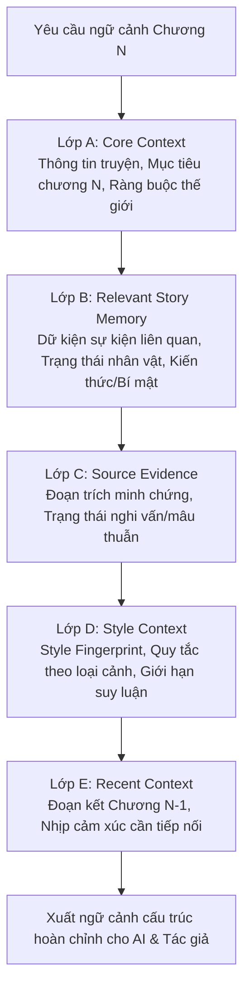
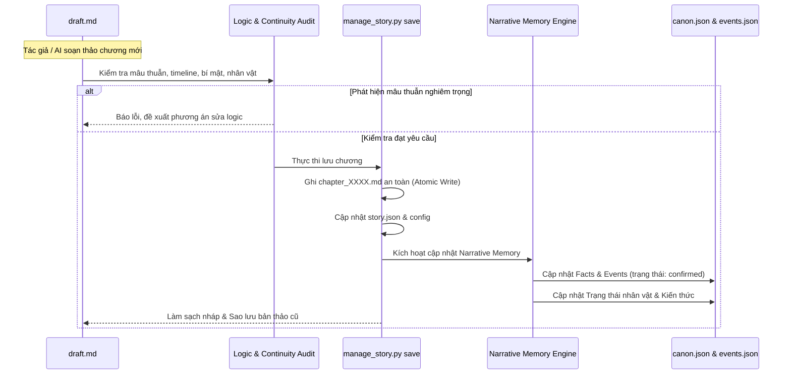

# NARRATIVE MEMORY ENGINE — DESIGN DOCUMENT
## SVB-STORY PHASE 2: LONG-FORM FICTION ARCHITECTURE

**Phiên bản:** 2.0.0  
**Tác giả:** Senior AI Agent Architect & Narrative Systems Engineer  
**Kho mã nguồn:** `c:\Novels\CreateSkills\story-flow`  
**Ngày lập:** 21/10/2026  

---

## 1. Kiến trúc hiện trạng & Các thành phần có thể tái sử dụng

### 1.1. Khảo sát hiện trạng (Baseline sau Giai đoạn 1)
- **`manage_story.py`**:
  - Đã có cơ chế ghi tệp an toàn (Atomic write với file tạm `.tmp.*`, atomic JSON dump).
  - Đã có lưu trữ bản nháp an toàn: sao lưu bản nháp cũ vào `chapters/.draft_backups/draft_*.md` trước khi xử lý, không xóa nháp nếu lưu thất bại.
  - Hỗ trợ phân tích văn phong Style Engine 2.0 (`scripts/style_analyzer.py`), lưu trữ đa tầng (Story-level tại `summaries/style_profiles/` và Global-level tại `style_library/`).
  - Lệnh `context` hiện tại (`action_context`): hiển thị Rolling summary (mốc 10 chương), các chương chưa gộp tóm tắt, đề cương `outline.md`, phục bút `foreshadow.json`, đường dẫn `character_bible.json`, `lorebook.json`, và active style profile.
  - Quản lý siêu dữ liệu: `story_config.json`, `story.json` (danh sách chương, tóm tắt brief, đường dẫn file).

### 1.2. Các thành phần tái sử dụng
- **Atomic IO Engine**: Các hàm `atomic_write`, `atomic_save_json`, `archive_draft_backup` được tái sử dụng toàn bộ để bảo vệ tính toàn vẹn của tệp tin.
- **Style Engine 2.0**: Schema 2.0.0 với các metric 5 trục (âm tiết, phân loại cảnh, độ tin cậy) được giữ nguyên và tích hợp vào Lớp D (Style Context).
- **Subcommand Structure**: Hệ thống phân tích đối số `argparse` được mở rộng thêm lệnh con `memory` thay vì thay thế các lệnh hiện hành.

---

## 2. Vấn đề bộ nhớ truyện còn tồn tại

Mặc dù hệ thống đã có `character_bible.json`, `lorebook.json`, `foreshadow.json` và `rolling_summary.txt`, qua kiểm toán thực tế phát hiện các điểm nghẽn nghiêm trọng cho sáng tác truyện dài:

1. **Bộ nhớ tĩnh (Static memory) thay vì tiến trình (Dynamic state):**
   - `character_bible.json` chỉ lưu trữ hồ sơ tĩnh hoặc danh sách các lần cập nhật rời rạc. Không thể truy vấn: *"Tại chương 15, nhân vật A đang ở trạng thái thể chất nào, đang mang vật phẩm gì, và có thiện cảm hay thù hận với B?"*.
2. **Không phân biệt được Sự thật thế giới (World Truth) và Niềm tin nhân vật (Character Belief):**
   - Khi nhân vật A tin rằng sư phụ bị B giết (nhưng thực tế là do C hãm hại), hệ thống trước đây không phân tách được hai dữ kiện này. Dẫn đến nguy cơ AI tự động coi lời nói của nhân vật là chân lý thế giới, gây mâu thuẫn plot sau này.
3. **Mù thông tin nhân vật biết (Knowledge & Secret Tracking deficit):**
   - AI khi viết chương mới dễ mắc lỗi "thấu thị" (omniscient leak): cho nhân vật B hành động hoặc nói chuyện như thể đã biết một bí mật mà chỉ nhân vật A và độc giả biết.
4. **Thiếu nguồn gốc kiểm chứng (Provenance deficit):**
   - Các tóm tắt trong `rolling_summary.txt` được coi là chân lý mặc định mà không thể truy ngược về đoạn trích (quote) hoặc chương gốc nào đã sinh ra chi tiết đó. Khi summary bị "ảo giác" (hallucination), sai số bị tích tụ và khuếch đại qua các chương sau.
5. **Cập nhật thiếu kiểm định (Unverified memory mutation):**
   - Chưa có cơ chế ngăn một bản nháp chưa lưu ghi đè dữ kiện của các chương trước đó, hoặc tự động biến phỏng đoán thành canon.

---

## 3. Phản biện kiến trúc — Matt Grill With Docs (10 Câu hỏi cốt lõi)

Tài liệu này ghi nhận kết quả phản biện nghiêm ngặt theo phương pháp Matt Pocock:

### Q1: Canon của truyện là gì?
- **Quyết định:** Canon là tập hợp các dữ kiện, quy tắc thế giới, sự kiện, quan hệ, trạng thái vật phẩm/nhân vật đã được **xác nhận chính thức** trong các chương đã lưu hợp lệ (`chapter_XXXX.md` được ghi nhận trong `story.json`).
- **Giới hạn:** Bản nháp (`draft.md`), đề cương tương lai (`outline.md`), hoặc tóm tắt sơ bộ không phải là Canon.

### Q2: Một sự kiện khi nào được xem là đã xác nhận (Confirmed)?
- **Quyết định:** Sự kiện được coi là `confirmed` khi và chỉ khi:
  1. Nó xuất hiện trực tiếp trong văn bản chương đã lưu chính thức.
  2. Có tham chiếu rõ ràng (`chapter_number`, đoạn trích minh chứng).
  3. Không có xung đột chưa giải quyết với các quy tắc thế giới bất biến.
- **Phương án loại bỏ:** Tự động coi mọi sự kiện AI trích xuất được là confirmed ngay lập tức (loại vì AI trích xuất có thể nhầm lẫn suy luận thành sự kiện).

### Q3: Khi nào bản nháp được phép cập nhật bộ nhớ chính thức?
- **Quyết định:** **Chỉ sau khi** chương được lưu thành công vào đĩa và `story.json` được cập nhật. Nếu khâu kiểm tra hoặc lưu thất bại, tuyệt đối không sửa đổi bộ nhớ Canon.

### Q4: Làm thế nào phân biệt sự thật, lời nói dối, hiểu lầm và suy luận của nhân vật?
- **Quyết định:** Tách bạch trường dữ liệu `fact_type`:
  - `world_truth`: Sự thật khách quan diễn ra trong thế giới truyện.
  - `character_belief`: Nhận thức chủ quan của nhân vật (kèm theo `believer_id`, `accuracy`: `true` | `false` | `uncertain`).
  - `character_deception`: Lời nói dối có chủ đích của nhân vật A đối với B.

### Q5: Làm thế nào ngăn việc tiết lộ bí mật trước thời điểm hợp lý?
- **Quyết định:** Mô hình hóa `Secret`:
  - Mỗi bí mật có `known_by: [list_of_characters]`, `reader_aware: bool`, `reveal_milestone`.
  - Khi tạo Context cho một cảnh, chỉ các nhân vật có tên trong `known_by` mới được nạp thông tin này dưới dạng kiến thức. Đối với các nhân vật khác, hệ thống sinh ra ràng buộc âm tính có kiểm soát (Negative Constraint): *"Nhân vật X hoàn toàn chưa biết về Y; không được để X nhắc đến hoặc phản ứng dựa trên Y"*.

### Q6: Khi summary và chương gốc mâu thuẫn, nguồn nào được ưu tiên?
- **Quyết định:** **Chương gốc (`chapter_XXXX.md`) là nguồn chân lý tối cao.** Summary chỉ là chỉ mục phái sinh. Nếu phát hiện mâu thuẫn, hệ thống đánh dấu summary là lỗi thời (`stale`), ưu tiên văn bản chương gốc và cảnh báo tác giả.

### Q7: Khi hai chương có bằng chứng mâu thuẫn, hệ thống cần làm gì?
- **Quyết định:** Đưa dữ kiện vào trạng thái `disputed`. Lưu giữ đồng thời cả 2 provenance (Chương A vs Chương B). Cấm tự động ghi đè bên này bằng bên kia. Xuất cảnh báo trong báo cáo Audit để tác giả xử lý hoặc giải thích qua chi tiết truyện (ví dụ: nhân vật phát hiện chương A là tin giả).

### Q8: Khi nào cần đọc lại toàn bộ một chương thay vì chỉ lấy đoạn trích?
- **Quyết định:** Bắt buộc đọc toàn văn khi:
  1. Chương liền kề trước đó ($N-1$) để duy trì mạch cảm xúc và nhịp văn liên tục.
  2. Khi phát hiện mâu thuẫn (`disputed`) mà đoạn trích không đủ làm rõ ngữ cảnh thoại/hành động.
  3. Khi chương được đánh dấu là bước ngoặt lớn của Arc truyện (Climax/Turning Point).

### Q9: Làm thế nào theo dõi sự phát triển tâm lý mà không đóng băng tính cách nhân vật?
- **Quyết định:** Phân biệt `core_traits` (nền tảng) và `dynamic_state` (mục tiêu ngắn hạn, cảm xúc hiện thời, chấn thương, sự thay đổi quan điểm). Mỗi bước chuyển biến tâm lý lớn phải gắn liền với một `trigger_event_id` (biến cố làm nguyên nhân).

### Q10: Làm thế nào kiểm tra logic mà không khiến văn chương trở nên máy móc?
- **Quyết định:** Phân chia 4 cấp độ cảnh báo:
  - **Lỗi nghiêm trọng (Critical):** Phá vỡ nhân quả, hồi sinh nhân vật đã chết vô căn cứ, đồ vật dịch chuyển tức thời, bí mật lộ sai người. Bắt buộc sửa.
  - **Lệch đáng kể (Significant):** Suy yếu động cơ hoặc continuity. Khuyến nghị sửa.
  - **Lệch mềm (Soft):** Biến thiên độ dài câu, tỷ lệ thoại. Chỉ mang tính tham khảo.
  - **Lựa chọn nghệ thuật (Artistic Choice):** Chủ ý nghệ thuật, phép ẩn dụ, dòng ý thức. Bảo toàn nguyên trạng.

---

## 4. Mô hình dữ liệu đề xuất (Data Models)

Hệ thống Narrative Memory được lưu trữ tại thư mục `stories/<active_story_id>/summaries/memory/`:

```
stories/<active_story>/summaries/memory/
├── canon.json             # Các dữ kiện chân lý thế giới và quy tắc bất biến
├── events.json            # Trục sự kiện nhân quả (Causal Event Chain)
├── characters_state.json  # Trạng thái nhân vật theo tiến trình thời gian
├── knowledge.json         # Ma trận kiến thức & bí mật (Ai biết điều gì)
└── conflicts.json         # Danh sách các mâu thuẫn đang tranh chấp
```

### 4.1. Fact Model (`canon.json`)
```json
{
  "fact_id": "fact_001",
  "subject": "Dạ Lão",
  "predicate": "status",
  "object": "bị phong ấn trong Cổ Giới Chỉ",
  "fact_type": "world_truth",
  "state": "confirmed", // confirmed | draft | inferred | disputed | unresolved | retracted
  "provenance": {
    "chapter": 1,
    "quote": "Linh hồn Dạ Lão thức tỉnh từ chiếc nhẫn đen cũ kỹ.",
    "confidence": 1.0,
    "timestamp": "2026-10-21T10:00:00Z"
  },
  "tags": ["dạ_lão", "cổ_giới_chỉ", "thế_lực"]
}
```

### 4.2. Event Model (`events.json`)
```json
{
  "event_id": "evt_ch003_01",
  "chapter": 3,
  "sequence_index": 1,
  "title": "Trận chiến Hắc Phong Lĩnh",
  "summary": "Lâm Phong kích hoạt bí thuật đẩy lùi Liễu Thanh nhưng kinh mạch bị tổn thương.",
  "relative_time": "Ngày thứ 3 sau khi rời thành",
  "characters_involved": ["Lâm Phong", "Liễu Thanh"],
  "witnesses": ["Lâm Phong", "Liễu Thanh", "Thanh Mai"],
  "cause_events": ["evt_ch002_03"],
  "consequence_events": [],
  "lasting_changes": [
    "Lâm Phong: kinh mạch cánh tay phải bị rạn nứt, cần 7 ngày dưỡng thương",
    "Liễu Thanh: đánh rơi ngọc bội gia tộc"
  ],
  "status": "confirmed"
}
```

### 4.3. Character Dynamic State (`characters_state.json`)
```json
{
  "character_name": "Lâm Phong",
  "current_chapter": 4,
  "goals": {
    "primary": "Tìm Hồi Huyết Thảo để chữa trị kinh mạch tay phải",
    "secondary": "Giấu tung tích Dạ Lão trước Thanh Mai"
  },
  "emotional_state": "Căng thẳng nhưng kiên định",
  "physical_state": {
    "injuries": ["Kinh mạch tay phải bị rạn (Chương 3)"],
    "location": "Sơn động ngoại vi Hắc Phong Lĩnh",
    "inventory": ["Cổ Giới Chỉ", "Thanh Phong Kiếm (gãy mũi)", "3 lượng bạc"]
  },
  "beliefs": {
    "Liễu gia muốn diệt Lâm gia": {
      "is_world_truth": true,
      "source_chapter": 2
    },
    "Thanh Mai là người của Liễu gia cài cắm": {
      "is_world_truth": false, // Hiểu lầm của nhân vật
      "source_chapter": 3,
      "note": "Lâm Phong nghi ngờ sau khi thấy Thanh Mai nói chuyện với thị vệ"
    }
  },
  "relationships": {
    "Liễu Thanh": "Kẻ thù sinh tử",
    "Thanh Mai": "Đồng hành nhưng còn cảnh giác",
    "Dạ Lão": "Thầy trò / Chỗ dựa bí mật"
  }
}
```

### 4.4. Knowledge & Secret Tracking (`knowledge.json`)
```json
{
  "secrets": [
    {
      "secret_id": "sec_001",
      "title": "Thân phận thực sự của Dạ Lão",
      "summary": "Dạ Lão nguyên là Dược Tôn của Thượng Giới, bị đệ tử phản bội.",
      "owner": "Dạ Lão",
      "known_by": ["Dạ Lão", "Lâm Phong"],
      "reader_aware": true,
      "reveal_conditions": "Chỉ tiết lộ cho người thứ 3 khi gặp người của Vạn Dược Tông",
      "status": "concealed", // concealed | partially_revealed | exposed
      "introduced_chapter": 1
    }
  ]
}
```

---

## 5. Quy trình Context Builder 5 lớp (5-Layer Context Pipeline)

Khi tác giả hoặc Skill gọi `python manage_story.py context`:



---

## 6. Vòng đời dữ kiện: Từ Bản nháp (Draft) đến Canon



---

## 7. Kế hoạch triển khai & Tương thích ngược

1. **Không phá vỡ cấu trúc cũ:** Toàn bộ các file hiện có (`rolling_summary.txt`, `character_bible.json`, `lorebook.json`, `foreshadow.json`, `outline.md`) vẫn được duy trì hoạt động song song.
2. **Khởi tạo tự động (Lazy init / Graceful degradation):** Nếu một câu chuyện chưa có thư mục `summaries/memory/`, hệ thống tự động khởi tạo cấu trúc mặc định mà không làm gián đoạn tiến trình viết.
3. **CLI trực quan:** Bổ sung nhóm lệnh `python manage_story.py memory` hỗ trợ:
   - `--audit`: Quét mâu thuẫn toàn diện.
   - `--timeline`: Hiển thị chuỗi sự kiện.
   - `--char <name>`: Hiển thị tiến trình nhân vật.
   - `--secrets`: Hiển thị trạng thái bí mật.
   - `--query <keyword>`: Truy xuất bằng chứng.
4. **Bộ kiểm thử toàn diện:** Bổ sung unit tests cho Narrative Memory Engine và 10 kịch bản kiểm thử truyện dài nhiều chương (Long-novel regression).
