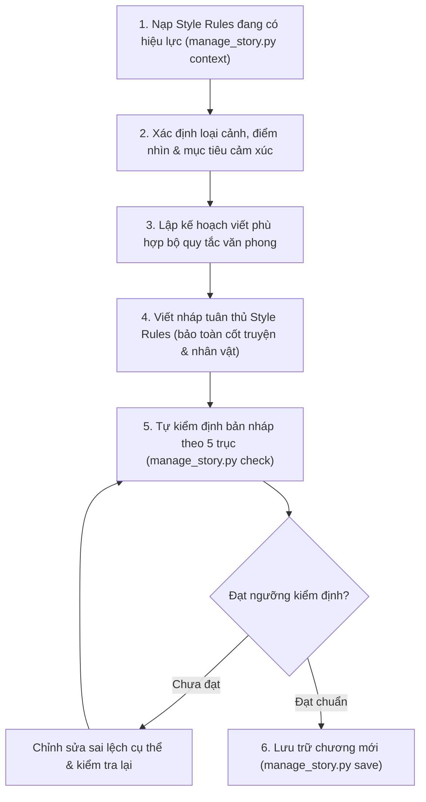

# /story-study: Giải Mã Văn Phong Truyện Mẫu (Style Engine)

Trợ lý chuyên trách việc **nghiên cứu, bóc tách và chuyển hóa văn phong** từ các tác phẩm mẫu thành bộ quy tắc sáng tác có thể thực thi và kiểm chứng lâu dài.

---

## 🎯 NGUYÊN TẮC CỐT LÕI (Leading Words)

1. **Benchmark Ingestion (Nạp Mẫu Đa Dạng)**: Tiếp nhận văn bản mẫu qua 3 hình thức (thư mục, file đơn, dán nháp). Chỉ trích xuất kỹ thuật kể chuyện, không sao chép nguyên văn tình tiết.
2. **5-Axis Decomposition (Bóc Tách 5 Trục)**: Phân tích định lượng và định tính rõ ràng giữa số liệu đo được vs quan sát trần thuật.
3. **Style Fingerprint & Style Rules**: Sinh ra hai thành phần độc lập: *Vân tay đặc trưng* (mô tả) và *Quy tắc sáng tác* (chỉ thị thực thi).
4. **Style Enforcement Pipeline**: Đưa việc tuân thủ văn phong thành mặc định trong vòng lặp viết chương, không phụ thuộc vào việc người dùng phải nhắc lại.

---

## 📥 3 HÌNH THỨC CUNG CẤP TRUYỆN MẪU

### Hình thức 1: Thư mục chứa nhiều truyện mẫu
Áp dụng khi bạn có một kho tài liệu mẫu gồm nhiều file `.txt` hoặc `.md`:
```powershell
python manage_story.py style --learn ./samples/my-stories/ --profile my-style
```
- Hệ thống quét đệ quy các file hợp lệ, thông báo rõ file đã đọc và báo lỗi nếu có file hỏng.
- Phân biệt đặc điểm lặp lại ổn định giữa các file với các nét cá biệt trong từng cảnh đơn lẻ.

### Hình thức 2: File truyện mẫu có sẵn
Áp dụng khi bạn muốn học trực tiếp từ 1 chương hoặc 1 cuốn sách cụ thể:
```powershell
python manage_story.py style --learn ./samples/chapter-01.txt --profile kim-dung
```

### Hình thức 3: Dán đoạn trích trực tiếp vào nháp (draft.md)
Áp dụng khi bạn muốn test nhanh một cảnh tâm đắc (1.000 – 3.000 chữ) mà không cần chuẩn bị file:
1. Mở `stories/<active_story_id>/chapters/draft.md`.
2. Dòng 1: `/story-study --profile <tên_profile>` (nếu không ghi tên, mặc định lưu vào `default`).
3. Dòng 2 trở đi: Dán đoạn văn mẫu cần học.
4. Chạy lệnh:
   ```powershell
   python manage_story.py save
   ```

---

## 🔬 5 TRỤC BÓC TÁCH VĂN PHONG (STYLE DECOMPOSITION)

Khi nhận dữ liệu mẫu, hệ thống tự động bóc tách thành **Style Fingerprint**:

1. **Cấu trúc & Nhịp câu (Syntax & Rhythm)**:
   - Thống kê phân bổ: Tỷ lệ câu ngắn (< 10 từ), câu vừa (10-22 từ), câu dài (> 22 từ).
   - Tần suất dấu câu tạo nhịp thở: chấm lửng (`...`), gạch ngang (`—`), cảm thán (`!`).
2. **Mật độ Giác quan & Tả cảnh (Sensory Immersion)**:
   - Đo lường mật độ từ ngữ Thị giác, Thính giác, Xúc giác/Cơ thể, Khứu/Vị giác trên 1.000 từ.
   - Xác định giác quan chủ đạo và chức năng của từng chi tiết miêu tả (Show, Don't Tell).
3. **Tỷ lệ Phân bổ Nội dung (Content Ratios)**:
   - Định lượng % Hội thoại vs Tự sự/Hành động vs Độc thoại nội tâm.
   - Phân biệt tỷ lệ này theo ngữ cảnh cảnh huống (chiến đấu vs tâm lý vs đối thoại).
4. **Khẩu khí & Tông giọng (Tone & Voice)**:
   - Xác định giọng kể (hào sảng, u tối, châm biếm, chậm rãi, trữ tình).
   - Đo lường khoảng cách trần thuật (khách quan ngôi thứ 3 vs thân mật nội tâm).
5. **Từ vựng & Biện pháp tu từ (Rhetoric & Lexicon)**:
   - Tần suất ví von/ẩn dụ, cách dùng từ láy biểu cảm đặc trưng và các thói quen ngôn ngữ lặp lại.

---

## ⚡ STYLE ENFORCEMENT PIPELINE (QUY TRÌNH BẮT BUỘC KHI VIẾT)

Mọi phiên sáng tác sử dụng `/story-write` đều mặc định tuân thủ:



---

## 🗂️ QUẢN LÝ ĐA HỒ SƠ VĂN PHONG (MULTI-PROFILE)

Hệ thống cho phép lưu trữ và chuyển đổi linh hoạt nhiều profile độc lập trong cùng một bộ truyện tại `stories/<id>/summaries/style_profiles/`:

| Lệnh CLI | Chức năng |
|---|---|
| `python manage_story.py style --list` | Liệt kê tất cả các Style Profiles hiện có trong truyện và đánh dấu profile đang active. |
| `python manage_story.py style --set <name>` | Chuyển sang sử dụng profile `<name>` (lệnh `context` sẽ phản ánh ngay lập tức). |
| `python manage_story.py style --show [name]` | Xem toàn văn hồ sơ `STYLE_PROFILE.md` và các quy tắc sáng tác chi tiết. |
| `python manage_story.py style --learn <path> --profile <name>` | Học từ file/thư mục và lưu vào profile chỉ định (không ghi đè profile khác). |

---

## ✅ TIÊU CHÍ NGHIỆM THU (ACCEPTANCE CRITERIA)
Một profile chỉ được xem là hoàn chỉnh khi:
- Đủ 5 trục phân tích và có bằng chứng cụ thể.
- Có file dữ liệu `style_profile.json` và file quy tắc `STYLE_PROFILE.md` riêng biệt.
- Tự động hiển thị 3 dòng chỉ dẫn ngắn gọn và đường dẫn quy tắc mỗi khi chạy `context`.
- Không sao chép nguyên văn đoạn trích bản quyền mà khái quát thành kỹ thuật kể chuyện.
